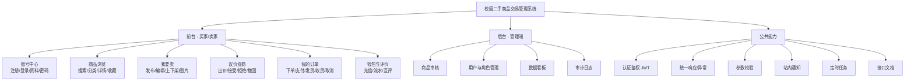
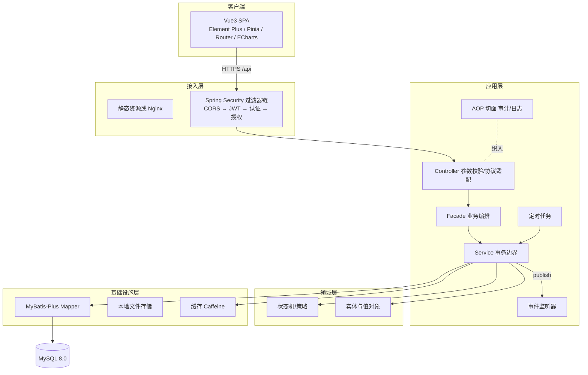
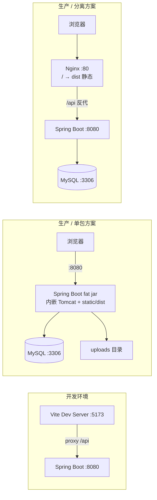
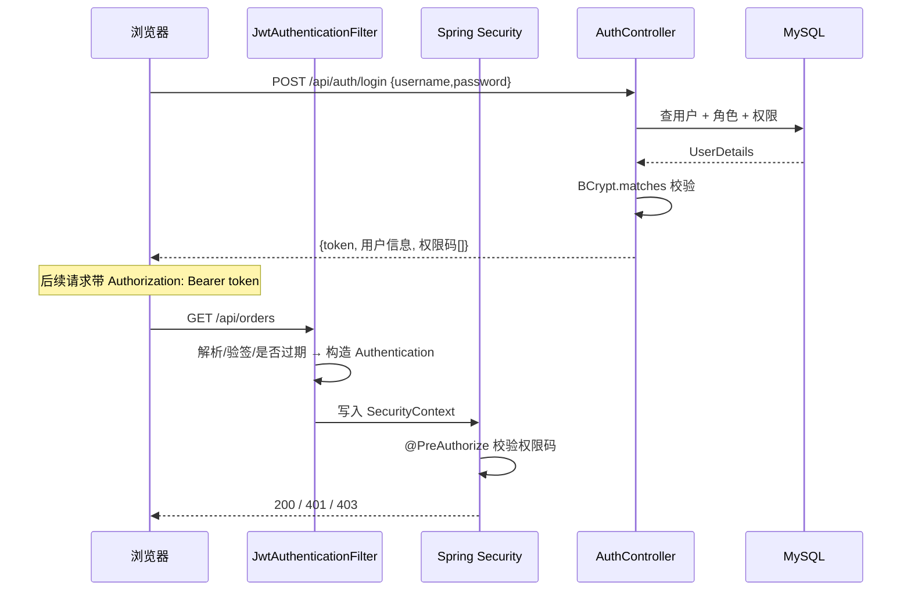
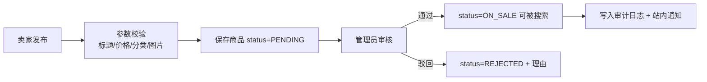
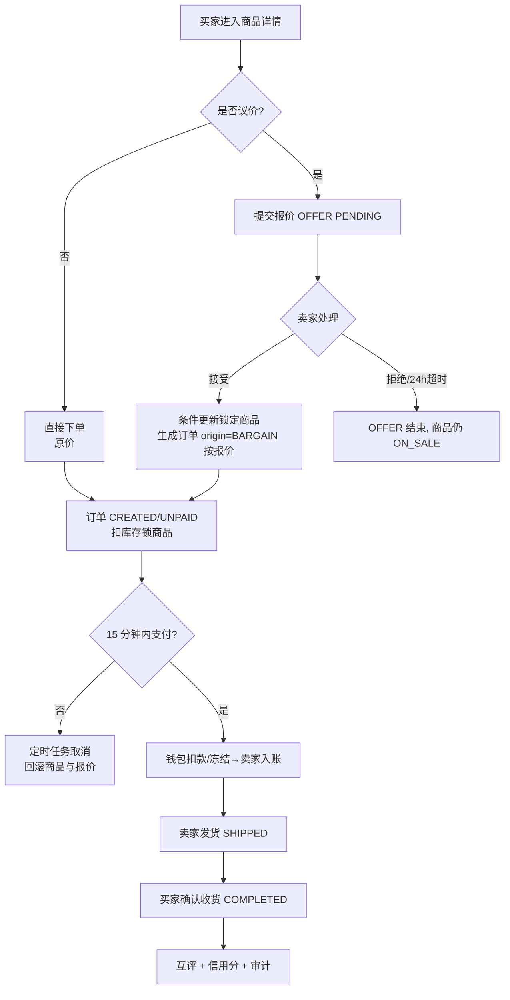

# 实验四 总体设计（Step 1 产出）

> 校园二手商品交易管理系统 —— SpringBoot + Vue3 + MySQL 前后端分离重构
> 对应实验报告第三章第 1~6 条：软件功能、创新点/特色、总体设计思想、设计模式、程序架构、主要执行流程。

---

## 1 系统定位与范围

| 项 | 内容 |
|---|---|
| 系统名称 | 校园二手商品交易管理系统（CampusTrade） |
| 建设目标 | 把实验 1（业务模型/命令行）、实验 2（RBAC 权限/注解反射）、实验 3（Servlet+JSP 单体 Web）的成果，重构为 **前后端分离** 的企业级应用 |
| 技术栈 | Spring Boot 3.3.5 + Spring Security 6 + MyBatis-Plus 3.5.9 + MySQL 8.0 + Redis 可选缓存 + Vue 3 + Vite 5 + Element Plus + Pinia + ECharts |
| 架构形态 | **单体后端 + SPA 前端**（题目明确"非后端分布式"），单库单实例，可水平扩展为多副本（无状态 JWT） |
| 用户角色 | 游客、普通用户(USER)、卖家(SELLER)、管理员(ADMIN)、超级管理员(SUPER_ADMIN) |
| 业务闭环 | 注册登录 → 发布商品 → 审核上架 → 浏览/搜索/收藏 → 直接下单 或 议价成交 → 钱包支付 → 发货收货 → 评价 → 结算入账 |

**与前三实验的关系**：实验 1 提供领域模型与交易规则，实验 2 提供 RBAC 与注解鉴权思想，实验 3 提供完整 Web 业务闭环与三处并发/越权缺陷的修复经验；实验 4 在此之上完成技术栈升级（Servlet → Spring MVC、JDBC → MyBatis-Plus、Session → JWT、MD5 → BCrypt、单角色 → 多角色 RBAC）。

---

## 2 软件功能设计

### 2.1 角色与权限模型

采用标准 **5 表 RBAC**（相比实验 2/3 的"用户表内单角色字段"升级为多对多，一个账号可同时具备 USER + SELLER）：

| 表 | 说明 |
|---|---|
| `sys_user` | 账号主体（含钱包余额、状态、信用分） |
| `sys_role` | 角色：SUPER_ADMIN / ADMIN / USER / SELLER |
| `sys_user_role` | 用户-角色（多对多） |
| `sys_permission` | 权限点：`menu:*` 菜单、`btn:*` 按钮、`api:*` 接口 |
| `sys_role_permission` | 角色-权限（多对多） |

鉴权三级：**接口级**（`@PreAuthorize("hasAuthority('product:audit')")`）→ **数据级**（Service 内校验资源归属，防水平越权）→ **前端级**（`/auth/me` 返回权限码，路由守卫 + `v-permission` 指令控制菜单/按钮显隐）。

**角色设计说明（校园场景）**：平台不限制"只能买"或"只能卖"——**USER 角色同时拥有发布、下单、议价、发货、评价的权限，任何人注册后即可买卖**。`SELLER` 是**保留角色，仅作"认证卖家/店铺"身份标识**（权限集与 USER 完全一致），用于后续扩展优先展示、保证金、店铺主页等；当前不赋予任何独占能力，避免出现"同一校园用户要先申请卖家才能卖闲置"的割裂体验。

### 2.2 功能清单

| 编号 | 模块 | 功能点 | 使用角色 |
|---|---|---|---|
| F01 | 认证 | 注册（BCrypt）、登录（JWT）、退出、当前用户信息、修改密码 | 全部 |
| F02 | 商品 | 发布/编辑/下架/删除、图片上传（多图）、分类筛选、关键词搜索、价格区间、分页排序、浏览量 | USER/SELLER |
| F03 | 商品审核 | 待审核列表、通过、驳回（填理由） | ADMIN |
| F04 | 浏览 | 首页推荐位、商品详情、收藏/取消收藏、浏览足迹 | 全部 |
| F05 | 议价 | 买家出价（含留言）、卖家接受/拒绝、买家撤回、24h 自动过期、成交后锁定商品 | USER/SELLER |
| F06 | 订单 | 直接下单、议价成单、待支付超时自动取消、支付、卖家发货、买家收货、取消订单、订单列表/详情 | USER/SELLER |
| F07 | 钱包 | 余额查询、充值（模拟）、资金流水（收入/支出/退款） | USER/SELLER |
| F08 | 评价 | 确认收货后互评（1~5 星 + 文字）、商品详情展示评价、卖家信用分更新 | USER |
| F09 | 管理 | 用户列表/启禁用/重置密码、角色与权限分配、商品强制下架 | ADMIN/SUPER_ADMIN |
| F10 | 看板 | 交易额/订单量/用户量统计、近 7 日趋势、分类占比、热销商品 TopN（ECharts） | ADMIN |
| F11 | 审计 | 登录日志、关键业务操作留痕（AOP 切面）、审计查询与导出 | ADMIN |
| F12 | 通知 | 订单状态变更、议价结果、审核结果的站内消息（未读数） | USER |
| F13 | 文档 | Knife4j/OpenAPI 在线接口文档 | 开发者 |

### 2.3 功能组织图



---

## 3 创新点与特色功能

| 编号 | 特色 | 设计要点 | 体现的工程能力 |
|---|---|---|---|
| S1 | **结构化议价协商** | 独立 `bargain_offer` 表 + 状态机 + 24h 有效期；接受时用条件更新锁定商品（`UPDATE ... WHERE status='ON_SALE'`），解决"一物两卖" | 状态机、乐观并发、权限校验、审计 |
| S2 | **订单超时自动取消** | `@Scheduled` 扫描 `UNPAID` 且超 15 分钟的订单，回滚库存与议价单，`@Transactional` 保证一致性 | 定时任务、事务边界、批量处理 |
| S3 | **数据看板** | 一次聚合 SQL 出多指标 + 近 7 日趋势，ECharts 渲染 | SQL 聚合、接口设计、可视化 |
| S4 | **AOP 审计留痕** | 自定义 `@AuditLog` 注解 + 切面，异步写入，记录操作人/IP/入参摘要/耗时/结果 | AOP、异步线程池、注解驱动 |
| S5 | **多图上传与静态资源治理** | `MultipartFile` + 文件类型/大小白名单 + 随机文件名 + 按日期分目录 + 访问 URL 映射 | 文件安全、静态资源、路径穿越防护 |
| S6 | **事件驱动解耦** | 订单支付成功发布 `OrderPaidEvent`，通知、信用分、统计各自监听（`@TransactionalEventListener`） | Spring 事件机制、模块解耦 |
| S7 | **三实验成果整合** | 领域模型来自实验 1，权限来自实验 2，业务规则与缺陷修复来自实验 3，登录态由 Session 演进为 JWT | 技术演进叙事 |
| S8 | **接口文档即接口设计** | Knife4j 自动生成，报告第 7 条直接引用在线文档截图 | 规范化 |

> 说明：S1~S4 为本次核心特色，S5~S8 为体系性特色；答辩时重点演示 S1、S2。

---

## 4 总体设计思想

1. **分层解耦、单一职责**：`Controller`（协议适配）→ `Service`（业务编排/事务边界）→ `Mapper`（数据访问）→ `Entity`；DTO 与 PO 分离，禁止 Controller 直接暴露实体。
2. **约定优于配置**：统一 `Result<T>` 响应体、统一错误码、统一分页参数、统一异常处理，减少模板代码。
3. **安全内建（Security by Design）**：认证（JWT 无状态）、授权（RBAC + 方法级注解）、数据级归属校验、输入校验（Bean Validation）、输出脱敏、审计留痕，五道防线而非事后补丁。
4. **事务与并发显式化**：金额、库存、订单状态的写操作全部在 `@Transactional` 内，热点行使用条件更新/乐观锁，禁止"先查后改"。
5. **可演进**：业务规则（如议价自动成交、图片存储位置）以策略接口 + 配置开关组织，后续可接 OSS、可拆微服务。
6. **可观测**：结构化日志（traceId）、Actuator 健康检查、审计表、慢 SQL 日志。
7. **与课程衔接**：每一层都能对应到实验 1~3 的具体类，报告可讲"为什么这样演进"。

---

## 5 设计模式的使用

| # | 模式 | 落地位置 | 解决的问题 |
|---|---|---|---|
| 1 | 单例 | Spring 容器默认单例 Bean；`JwtUtil`、`IdGenerator` | 无状态工具复用，线程安全 |
| 2 | 工厂 | `BeanFactory`；`ImageStorageFactory`（local/oss 由配置决定） | 对象创建与使用分离 |
| 3 | 策略 | `BargainSettleStrategy`（自动成交/人工确认）；`OrderStateHandler` 各状态处理器 | 消除 if-else 分支膨胀 |
| 4 | 状态 | `OrderStatus` 枚举 + `OrderStateMachine` 校验流转 | 非法状态流转在编译/运行期被拒绝 |
| 5 | 模板方法 | `AbstractOrderStateHandler` 定义 `validate → execute → notify` 骨架 | 状态流转公共步骤复用 |
| 6 | 责任链 | Spring Security `FilterChain`（JWT → 认证 → 授权 → 业务） | 请求逐级过滤 |
| 7 | 观察者/事件 | `OrderPaidEvent` + `@TransactionalEventListener` | 支付后多动作解耦 |
| 8 | 代理 | Spring AOP：`@Transactional`、`@AuditLog`、`@PreAuthorize` | 横切关注点织入 |
| 9 | 建造者 | Lombok `@Builder` 构建 DTO/VO | 多参数对象可读 |
| 10 | 外观 | `TradeFacadeService` 收口"下单/支付/完成"跨聚合流程 | 降低 Controller 复杂度 |
| 11 | DAO/Mapper | `BaseMapper<T>` + 自定义 XML | 数据访问抽象 |
| 12 | 装饰器/适配器 | `ResponseBodyAdvice` 统一包装；`Page` 适配前端分页结构 | 协议统一 |
| 13 | 幂等令牌 | 下单/支付接口 `Idempotency-Key` + 唯一索引 | 重复提交 |
| 14 | 缓存旁路 | 权限码 `Cache-Aside`（Caffeine/Redis） | 高频鉴权降库压 |

---

## 6 程序架构

### 6.1 代码组织结构

```
exp4-springboot/
├── backend/                          # Spring Boot 单体后端
│   ├── pom.xml
│   └── src/main/
│       ├── java/com/zhj/exp4/
│       │   ├── Exp4Application.java           # 启动类
│       │   ├── common/                        # Result/ResultCode/PageResult/BizException/常量
│       │   ├── config/                        # SecurityConfig、MybatisPlusConfig、WebMvcConfig、
│       │   │                                  # JacksonConfig、OpenApiConfig、AsyncConfig
│       │   ├── security/                      # JwtUtil、JwtAuthenticationFilter、LoginUser、
│       │   │                                  # UserDetailsServiceImpl、PermissionService
│       │   ├── aspect/                        # AuditLogAspect、LogAspect
│       │   ├── controller/                    # Auth/Product/Category/Order/Bargain/Wallet/
│       │   │                                  # Review/User/AdminDashboard/Upload
│       │   ├── service/  service/impl/        # 业务接口与实现（事务边界）
│       │   ├── mapper/                        # MyBatis-Plus Mapper + XML
│       │   ├── entity/                        # 数据库映射对象 PO
│       │   ├── dto/request/  dto/response/    # 入参/出参
│       │   ├── enums/                         # OrderStatus、OfferStatus、ProductStatus、RoleCode
│       │   ├── event/ + listener/             # 领域事件与监听器
│       │   ├── task/                          # OrderTimeoutTask、OfferExpireTask
│       │   ├── statemachine/                  # 订单/议价状态机与处理器
│       │   └── util/                          # 加密、ID、分页、脱敏
│       └── resources/
│           ├── application.yml / application-dev.yml / application-prod.yml
│           ├── mapper/*.xml
│           ├── db/exp4_trade.sql
│           └── static/                        # 前端构建产物（生产单包部署）
├── frontend/                         # Vue 3 + Vite SPA
│   ├── package.json  vite.config.ts
│   └── src/{api,views,components,router,store,utils,styles,assets}
├── sql/exp4_trade.sql                # 建库建表 + 初始化数据
├── docs/                             # 设计/接口/安全/部署/测试/审查 文档
└── README.md                         # 启动与账号说明
```

分层依赖方向严格单向：`controller → service → mapper → db`，`common/config/security` 被各层引用，禁止反向依赖。

### 6.2 软件逻辑架构



### 6.3 部署架构



- **单包方案**（演示/答辩首选）：`npm run build` 产物拷入 `backend/src/main/resources/static`，`mvn package` 得到可执行 jar，`java -jar` 一条命令启动。
- **分离方案**（更贴近生产）：Nginx 托管 dist 并反代 `/api`，后端只提供接口。
- 数据库：Docker `mysql-rbac`（8.0，3306）新建库 `exp4_trade`，字符集 `utf8mb4`，与实验 3 库互不影响。
- 配置外置：`application-prod.yml` + 环境变量覆盖（`DB_PASSWORD`、`JWT_SECRET`），密钥不入库。

### 6.4 技术选型

| 层次 | 选型 | 版本 | 理由 |
|---|---|---|---|
| JDK | Microsoft OpenJDK | 21 | LTS，Spring Boot 3 要求 17+ |
| 框架 | Spring Boot | 3.3.5 | 企业主流，生态完整 |
| 安全 | Spring Security 6 + jjwt | 6.x / 0.12.6 | 无状态 JWT + BCrypt + 方法级授权 |
| 持久层 | MyBatis-Plus | 3.5.9 | 少样板、分页插件、逻辑删除 |
| 连接池 | HikariCP | 内置 | 高性能，替换实验 3 手写连接 |
| 缓存 | Caffeine（可选 Redis） | 3.1.8 | 权限码/字典缓存，无外部依赖即可演示 |
| 文档 | springdoc-openapi + Knife4j | 2.6.0 / 4.5.0 | 在线接口文档 |
| 数据库 | MySQL | 8.0 | 事务、行锁、窗口函数 |
| 前端 | Vue 3 + Vite + Element Plus + Pinia + ECharts | 3.5 / 5.4 / 2.8 / 2.2 / 5.5 | 主流组合，构建快 |
| 测试 | JUnit 5 + MockMvc + Testcontainers(可选) | 内置 | 接口层测试 |

---

## 7 程序主要执行流程

### 7.1 登录与鉴权流程



### 7.2 商品发布到上架



### 7.3 交易主流程（直接下单 / 议价成单）



### 7.4 关键事务与并发控制点

| 场景 | 措施 |
|---|---|
| 下单抢最后一件 | `UPDATE product SET status='LOCKED' WHERE id=? AND status='ON_SALE'`，返回 0 行即失败 |
| 议价接受 | 同上条件更新 + `offer` 状态条件更新，双保险 |
| 钱包扣款 | `UPDATE sys_user SET balance=balance-? WHERE id=? AND balance>=?`，禁止负余额 |
| 重复提交 | `Idempotency-Key` + 唯一索引 |
| 超时取消与支付竞态 | 订单状态 CAS：`WHERE status='UNPAID'` |

---

## 8 本步产出与下一步

- 产出：本文件（功能/特色/思想/模式/架构/流程），后续报告第 1~6 条直接引用。
- 下一步（Step 2）：ER 图、13 张表的 DDL 与字段说明、REST 接口清单（路径/方法/权限/入参/出参/错误码）、安全设计、部署方案细化 → `sql/exp4_trade.sql` + `docs/02-数据与接口.md`。
