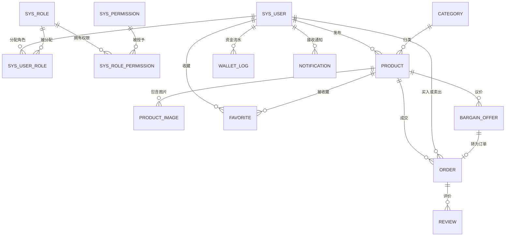

# 实验四 数据与接口设计（Step 2 产出）

> 对应实验报告第三章第 7 条（前后端交互接口设计）、第 8 条（安全设计）、第 10 条（实体类与数据库表设计）。
> 配套脚本：[sql/exp4_trade.sql](../sql/exp4_trade.sql)（16 张表 + 初始化数据，已在本地 MySQL 8.0.46 执行通过）。

---

## 1 数据库设计

### 1.1 设计原则

| 原则 | 说明 |
|---|---|
| 第三范式为主 | 分类、角色、权限独立成表；仅 `order` 冗余 `amount`（成交价快照，商品改价不影响历史订单） |
| 单件交易建模 | 校园二手商品天然唯一，一个订单只含一件商品，**不设 order_item**，用 `UNIQUE(bargain_offer.id)` 保证一张报价单只能成交一次 |
| 状态用字符串枚举 | `status VARCHAR(16)` 而非数字，SQL 与日志可读；状态机约束由应用层 `OrderStatus` 枚举保证 |
| 金额 DECIMAL | `DECIMAL(12,2)`，禁止 float/double，避免 0.1+0.2 精度问题 |
| 审计友好 | 全部业务表带 `create_time`；关键表带 `update_time`；`sys_user` 用 `deleted` 逻辑删除 |
| 索引贴合查询 | 商品 `(status, category_id)`、订单 `(buyer_id, status)`/`(seller_id, status)`/`(status, create_time)`、审计 `create_time` |

### 1.2 实体关系图



### 1.3 表清单（16 张）

| # | 表 | 说明 | 关键约束 |
|---|---|---|---|
| 1 | `sys_user` | 用户（余额、信用分、状态） | `uk_username` |
| 2 | `sys_role` | 角色（4 个） | `uk_code` |
| 3 | `sys_user_role` | 用户-角色 | `uk_user_role` |
| 4 | `sys_permission` | 权限点（31 个：菜单/按钮/接口） | `uk_code` |
| 5 | `sys_role_permission` | 角色-权限（83 条） | `uk_role_perm` |
| 6 | `category` | 商品分类（6 个） | `uk_name` |
| 7 | `product` | 商品（状态机 + 底价 + 成色） | 索引 `(status, category_id)` |
| 8 | `product_image` | 商品多图 | `idx_product` |
| 9 | `favorite` | 收藏夹（幂等） | `uk_user_product` |
| 10 | `order` | 订单（成交价快照） | `uk_order_no`、`uk_offer` |
| 11 | `bargain_offer` | 议价报价单 | 索引 `(status, expire_time)` |
| 12 | `review` | 双向评价 | `uk_order_reviewer` |
| 13 | `wallet_log` | 资金流水（含变动后余额） | `idx_user_create` |
| 14 | `notification` | 站内通知 | `idx_user_read` |
| 15 | `audit_log` | 操作审计 | `idx_create`、`idx_module` |
| 16 | `login_log` | 登录日志 | `idx_create` |

### 1.4 核心表字段设计（报告第 10 条直接引用）

**product（商品）**

| 字段 | 类型 | 说明 |
|---|---|---|
| id | BIGINT PK | 自增主键 |
| seller_id | BIGINT | 卖家，逻辑关联 `sys_user.id` |
| category_id | BIGINT | 分类 |
| title / description | VARCHAR | 标题 64 / 描述 1000 |
| price | DECIMAL(10,2) | 售价 |
| min_price | DECIMAL(10,2) | **卖家底价**，仅参与自动成交判断，接口不返回 |
| allow_bargain | TINYINT | 是否允许议价 |
| condition_level | VARCHAR(16) | 成色（全新/99新/95新/9成新/8成新） |
| location | VARCHAR(64) | 校内交易地点 |
| status | VARCHAR(16) | PENDING/ON_SALE/LOCKED/SOLD/REJECTED/OFF_SHELF |
| audit_remark | VARCHAR(255) | 审核意见 |
| views | INT | 浏览量 |

**status 状态机**：`PENDING →(审核通过) ON_SALE →(下单/议价成交) LOCKED →(支付完成) SOLD`；`PENDING →(驳回) REJECTED`；`ON_SALE →(卖家下架) OFF_SHELF`；`LOCKED →(订单取消) ON_SALE`（回滚）。

**order（订单）**

| 字段 | 类型 | 说明 |
|---|---|---|
| order_no | VARCHAR(32) | 业务单号，唯一，格式 `ORD + yyyyMMddHHmmss + 4 位随机` |
| product_id / buyer_id / seller_id | BIGINT | 三方标识 |
| amount | DECIMAL(10,2) | 成交金额（原价或议价） |
| origin | VARCHAR(16) | DIRECT / BARGAIN |
| offer_id | BIGINT NULL | 议价成交对应报价单，`UNIQUE` 防重复成交 |
| status | VARCHAR(16) | UNPAID/PAID/SHIPPED/COMPLETED/CANCELLED |
| pay_time / ship_time / finish_time | DATETIME | 时间线，看板与超时判断依据 |
| cancel_reason | VARCHAR(255) | 取消原因 |

**bargain_offer（议价）**：`offer_price`、`message`、`status(PENDING/ACCEPTED/REJECTED/CANCELLED/EXPIRED)`、`expire_time`、`handled_time`。

### 1.5 初始化数据

| 对象 | 内容 |
|---|---|
| 角色 | SUPER_ADMIN / ADMIN / USER / SELLER |
| 账号（密码均 `123456`，BCrypt cost=10） | `admin`(超管)、`manager`(管理员)、`buyer1`、`buyer2`、`seller1`、`seller2` |
| 多角色示例 | `seller1`、`seller2` 同时具备 USER + SELLER |
| 商品 | 6 件：1 件 LOCKED（待支付）、1 件 PENDING（待审核）、1 件 SOLD（已完成）、3 件 ON_SALE |
| 订单 | 2 笔：1 笔 COMPLETED（可用于评价）、1 笔 20 分钟前创建的 UNPAID（**用于演示超时自动取消**） |
| 议价 | 1 条 PENDING（buyer2 对机械键盘出价 180） |
| 其他 | 1 条评价、3 条钱包流水、2 条通知、示例登录/审计日志 |

---

## 2 前后端接口设计

### 2.1 通用约定

- 统一前缀 `/api`，REST 风格；资源名复数，动作用子路径或 HTTP 方法表达。
- 认证：`Authorization: Bearer <JWT>`；除登录/注册/商品浏览外均需认证。
- 分页参数：`page`（从 1 开始）、`size`（默认 10，最大 50）；排序 `sort=price,asc`。
- 统一响应体：

```json
{ "code": 0, "message": "ok", "data": {...}, "traceId": "a1b2c3d4" }
```

- 分页数据体：`{ "records": [], "total": 0, "page": 1, "size": 10 }`
- 错误码：`0` 成功；`1001` 参数错误；`1002` 未登录/令牌失效；`1003` 无权限；`1004` 资源不存在；`2001` 业务规则拒绝（含 message 说明）；`5000` 系统异常。

### 2.2 接口清单（共 45 个）

**认证与个人**

| 方法 | 路径 | 权限 | 说明 |
|---|---|---|---|
| POST | `/api/auth/register` | 公开 | 注册（默认 USER 角色） |
| POST | `/api/auth/login` | 公开 | 登录，返回 token + 权限码 |
| POST | `/api/auth/logout` | 认证 | 退出（令牌加入黑名单） |
| GET | `/api/auth/me` | 认证 | 当前用户 + 角色 + 权限码 |
| PUT | `/api/auth/password` | 认证 | 修改密码（校验旧密码） |
| GET | `/api/notifications` | 认证 | 通知列表 |
| GET | `/api/notifications/unread-count` | 认证 | 未读数 |
| PUT | `/api/notifications/{id}/read` | 认证 | 标记已读 |

**商品与分类**

| 方法 | 路径 | 权限 | 说明 |
|---|---|---|---|
| GET | `/api/categories` | 公开 | 分类列表 |
| GET | `/api/products` | 公开 | 分页搜索：`keyword/categoryId/minPrice/maxPrice/sort` |
| GET | `/api/products/{id}` | 公开 | 详情（浏览量 +1，隐藏 min_price） |
| GET | `/api/products/{id}/reviews` | 公开 | 商品评价分页 |
| GET | `/api/products/mine` | 认证 | 我发布的商品（按状态筛选） |
| POST | `/api/products` | `product:publish` | 发布（初始 PENDING） |
| PUT | `/api/products/{id}` | `product:edit` | 编辑（仅卖家本人且未售出） |
| PUT | `/api/products/{id}/status` | `product:offline` | 上/下架 |
| DELETE | `/api/products/{id}` | `product:edit` | 逻辑删除（仅卖家、无进行中订单） |
| POST | `/api/upload/image` | 认证 | 上传图片（类型/大小校验，返回 URL） |

**收藏 / 议价**

| 方法 | 路径 | 权限 | 说明 |
|---|---|---|---|
| GET | `/api/favorites` | 认证 | 我的收藏 |
| POST | `/api/favorites/{productId}` | 认证 | 收藏（幂等） |
| DELETE | `/api/favorites/{productId}` | 认证 | 取消收藏 |
| POST | `/api/offers` | `bargain:offer` | 出价（含次数/金额/重复校验） |
| GET | `/api/offers/sent` | 认证 | 我发出的报价 |
| GET | `/api/offers/received` | 认证 | 我收到的报价 |
| POST | `/api/offers/{id}/accept` | `bargain:handle` | 接受 → 锁商品 + 生成订单 |
| POST | `/api/offers/{id}/reject` | `bargain:handle` | 拒绝 |
| POST | `/api/offers/{id}/cancel` | 认证 | 买家撤回 |

**订单 / 钱包 / 评价**

| 方法 | 路径 | 权限 | 说明 |
|---|---|---|---|
| POST | `/api/orders` | 认证 | 直接下单（`Idempotency-Key` 幂等） |
| GET | `/api/orders` | 认证 | 我的订单（`role=buyer/seller&status=`） |
| GET | `/api/orders/{id}` | 认证 | 详情（买卖双方可见） |
| POST | `/api/orders/{id}/pay` | `order:pay` | 钱包支付（扣款 + 入账 + 事件） |
| POST | `/api/orders/{id}/ship` | `order:ship` | 发货（仅卖家） |
| POST | `/api/orders/{id}/confirm` | `order:confirm` | 确认收货（仅买家） |
| POST | `/api/orders/{id}/cancel` | `order:cancel` | 取消（未支付可直接取消） |
| GET | `/api/wallet` | 认证 | 余额 + 统计 |
| POST | `/api/wallet/recharge` | `wallet:recharge` | 模拟充值 |
| GET | `/api/wallet/logs` | 认证 | 流水分页 |
| POST | `/api/reviews` | `review:create` | 评价（一单一评，双向） |
| GET | `/api/reviews/mine` | 认证 | 我的评价 |

**管理端**

| 方法 | 路径 | 权限 | 说明 |
|---|---|---|---|
| GET | `/api/admin/products` | `product:audit` | 待审核/全部商品 |
| POST | `/api/admin/products/{id}/audit` | `product:audit` | 通过/驳回（带意见） |
| POST | `/api/admin/products/{id}/force-offline` | `product:force-offline` | 强制下架 |
| GET | `/api/admin/users` | `user:manage` | 用户分页 |
| PUT | `/api/admin/users/{id}/status` | `user:manage` | 启用/禁用 |
| PUT | `/api/admin/users/{id}/reset-password` | `user:manage` | 重置密码 |
| GET | `/api/admin/roles` | `role:manage` | 角色列表（含权限） |
| PUT | `/api/admin/roles/{id}/permissions` | `role:manage` | 重新分配权限 |
| GET | `/api/admin/audit-logs` | `audit:view` | 审计日志分页 |
| GET | `/api/admin/login-logs` | `audit:view` | 登录日志分页 |
| GET | `/api/admin/dashboard/summary` | `dashboard:view` | 汇总指标 |
| GET | `/api/admin/dashboard/trend` | `dashboard:view` | 近 7 日趋势 |
| GET | `/api/admin/dashboard/categories` | `dashboard:view` | 分类占比 + 热销 TopN |

### 2.3 典型交互示例

**登录**

```http
POST /api/auth/login
{ "username": "buyer1", "password": "123456" }
→ { "code":0, "data": { "token":"eyJhbGciOi...", "user": {...}, "permissions": ["menu:product","order:pay", ...] } }
```

**商品搜索**

```http
GET /api/products?keyword=键盘&categoryId=1&minPrice=100&maxPrice=300&sort=price,asc&page=1&size=10
→ { "code":0, "data": { "records":[{ "id":2,"title":"机械键盘 青轴 87 键","price":200.00,"coverUrl":"/uploads/demo/keyboard.jpg","conditionLevel":"95新","sellerNickname":"数码小铺" }], "total":1,"page":1,"size":10 } }
```

**议价 → 成单**

```http
POST /api/offers        { "productId": 2, "offerPrice": 180.00, "message": "能便宜20吗" }
POST /api/offers/1/accept
→ { "code":0, "data": { "orderNo":"ORD202512211530120001", "amount":180.00 } }
```

---

## 3 安全设计

| 层次 | 威胁 | 措施 |
|---|---|---|
| 传输 | 明文窃听 | 生产环境 HTTPS；令牌仅在 Header 传输，不落 Cookie（避免 CSRF） |
| 认证 | 撞库、暴力破解 | BCrypt(cost=10) 加盐散列；登录失败计数（5 次/5 分钟锁定）；JWT 有效期 2h + 黑名单退出 |
| 授权（纵向） | 普通用户调用管理接口 | Spring Security `@PreAuthorize("hasAuthority('product:audit')")`，权限码由 RBAC 表加载 |
| 授权（横向） | 改 URL 操作他人订单/商品 | Service 层强制校验 `resource.ownerId == currentUserId`，不依赖前端隐藏按钮 |
| 输入 | SQL 注入 | MyBatis-Plus 预编译参数；排序字段白名单；`${}` 禁用 |
| 输入 | XSS | 后端 Hutool/自写 `HtmlUtils.escape` 过滤富文本；前端渲染默认转义，`v-html` 仅用于可信内容 |
| 输入 | 参数越界 | Jakarta Validation（`@NotBlank/@Min/@DecimalMin`）+ 全局异常处理统一返回 1001 |
| 文件 | 上传木马/路径穿越 | 白名单扩展名 + MIME 校验 + 大小 ≤ 5MB + 随机 UUID 文件名 + 按日期分目录 + 禁止 `..` |
| 金额 | 篡改/负数/超扣 | 金额由后端按商品价/报价单重算，忽略前端传值；`balance >= amount` 条件更新 |
| 并发 | 一物两卖、重复支付 | 商品 `WHERE status='ON_SALE'` 条件更新；订单状态 CAS；`Idempotency-Key` 唯一索引 |
| 数据 | 敏感信息泄露 | 响应 DTO 不含 password/min_price；日志脱敏（手机号中间 4 位掩码） |
| 运维 | 越权查看日志 | 审计接口仅 `audit:view`；审计日志只读、不提供删除接口 |
| 审计 | 事后追溯 | AOP `@AuditLog` 记录操作人/IP/入参摘要/耗时/结果，异步写入 |

---

## 4 部署方案

### 4.1 环境要求

| 组件 | 版本 | 说明 |
|---|---|---|
| JDK | 21（`F:\Java\ms-21.0.12.1`） | 注意本机默认 `JAVA_HOME` 是 26，构建 exp4 需切换 |
| Maven | 3.9.16 | `F:\Develop\Tools\apache-maven-3.9.16` |
| Node.js | 18+（本机 24.19） | 前端构建 |
| MySQL | 8.0（Docker `mysql-rbac`，3306，root/123456） | 库名 `exp4_trade` |

### 4.2 启动步骤

```bash
# 1) 初始化数据库
docker exec -i mysql-rbac mysql -uroot -p123456 --default-character-set=utf8mb4 < exp4-springboot/sql/exp4_trade.sql

# 2) 后端（开发）
cd exp4-springboot/backend
mvn spring-boot:run            # 默认 8080，profile=dev

# 3) 前端（开发，5173 代理到 8080）
cd exp4-springboot/frontend
npm install && npm run dev

# 4) 生产打包（单 jar 方案）
cd frontend && npm run build    # dist
cp -r dist/* ../backend/src/main/resources/static/
cd ../backend && mvn clean package -DskipTests
java -jar target/exp4-springboot-1.0.0.jar --spring.profiles.active=prod
```

### 4.3 配置项（`application.yml` 可被环境变量覆盖）

| 配置 | 默认值 | 环境变量 |
|---|---|---|
| 端口 | 8080 | `SERVER_PORT` |
| 数据库 URL | `jdbc:mysql://localhost:3306/exp4_trade?useUnicode=true&characterEncoding=utf8&serverTimezone=Asia/Shanghai` | `DB_URL` |
| 数据库账号 | root / 123456（仅开发） | `DB_USERNAME` / `DB_PASSWORD` |
| JWT 密钥 | dev 内置占位 | `JWT_SECRET`（生产必改，≥32 字节） |
| JWT 有效期 | 7200 秒 | `JWT_EXPIRE` |
| 上传目录 | `./uploads` | `UPLOAD_DIR` |
| 订单超时分钟 | 15 | `ORDER_TIMEOUT_MINUTES` |

### 4.4 目录与访问

- 上传文件映射 `/uploads/**` → `${UPLOAD_DIR}`，生产建议由 Nginx 直接托管。
- 健康检查：`GET /actuator/health`。
- 接口文档：`/doc.html`（Knife4j）、`/v3/api-docs`（OpenAPI JSON）。

---

## 6 后续补充（第三轮修复）

### 6.1 新增接口

| 方法 | 路径 | 权限 | 说明 |
|---|---|---|---|
| DELETE | `/api/upload/image?url=` | 认证 | 删除未被引用的上传图片（表单移除图片时调用） |
| GET | `/api/reviews/received` | 认证 | 我收到的评价（含卖家对买家的评价） |

### 6.2 安全与体验增强

| 项 | 说明 |
|---|---|
| 浏览量防刷 | 同一用户（未登录按 IP）对同一商品 30 分钟内只计一次，卖家自看不计数 |
| 底价自动成交 | 出价 ≥ `min_price` 时自动生成订单（与人工接受共用同一套 CAS 流程） |
| 上传孤儿清理 | `UploadCleanupTask` 每 6 小时删除"未被引用且超过 24 小时"的图片 |
| 静态资源 404 | `NoResourceFoundException` 单独处理为 HTTP 404，避免"文件已删仍返回 200" |
| 登录审计去重 | 登录事件只写 `login_log`，不再产生 `anonymous 认证/登录` 的审计冗余 |
| 时区一致 | JDBC 使用 `connectionTimeZone=Asia/Shanghai&forceConnectionTimeZoneToSession=true`，订单/报价时间由 Java 显式写入 |
| 菜单权限生效 | 前端路由 meta 与头像下拉均按 `menu:*` 权限码过滤，RBAC 不再是"摆设" |

## 5 本步验证结果
| 检查项 | 结果 |
|---|---|
| DDL 在 MySQL 8.0.46 执行 | ✅ 无错误 |
| 表数量 | ✅ 16 |
| 初始化数据 | ✅ 用户 6、权限 29、角色权限 71、商品 6、订单 2、报价 1 |
| 中文存储 | ✅ `WHERE title LIKE '%键盘%'` 命中，字符集 utf8mb4 正确 |
| 多角色 | ✅ `seller1/seller2` = USER,SELLER |
| 演示数据可用性 | ✅ 存在 20 分钟前的 UNPAID 订单（定时任务演示）与 PENDING 议价单 |

下一步（Step 3）：后端骨架与安全层 —— pom、启动类、统一响应/异常、MyBatis-Plus 配置、JWT + Spring Security 配置、RBAC 权限加载、审计 AOP、Knife4j，跑通"登录拿 token → 访问受保护接口"。
